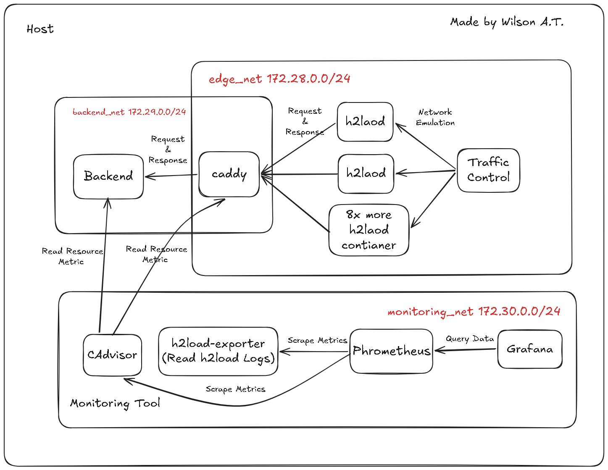
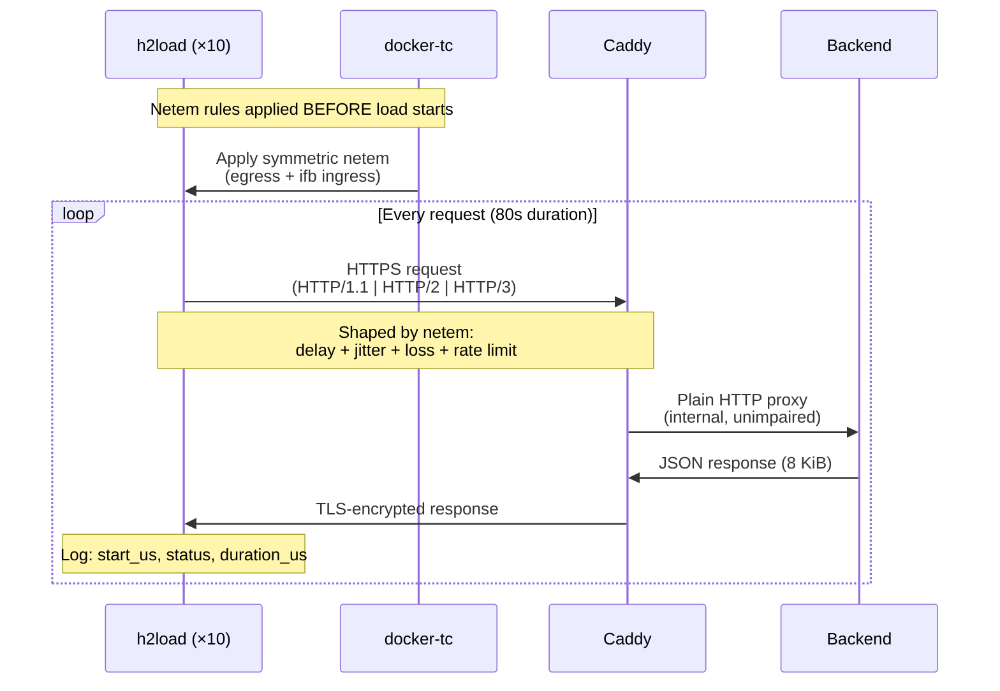
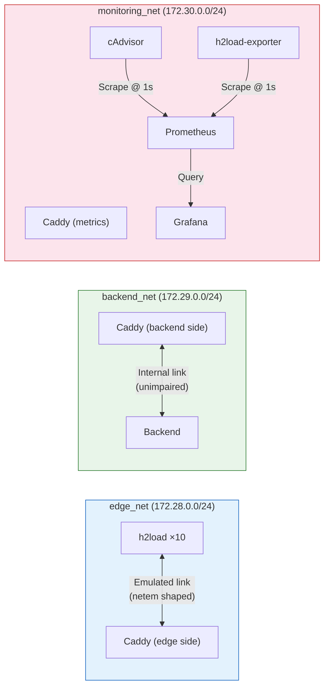

# System Overview

The testbed is a fully Dockerized environment that measures HTTP protocol performance under controlled network conditions. This page provides the high-level architecture diagram and explains how all components interact.

## Architecture Diagram

The following diagram illustrates the complete testbed topology and component interactions across the three isolated Docker networks:

*Figure 1: High-level testbed architecture showing `edge_net`, `backend_net`, and `monitoring_net`.*

## Request Flow

The data path for every request follows this route:

## Network Separation

The testbed uses three isolated Docker bridge networks to ensure clean measurement:

| Network | Subnet | Purpose | Shaped? |
| --- | --- | --- | --- |
| `edge_net` | `172.28.0.0/24` | Client ↔ Proxy traffic | ✅ Yes (netem per loader) |
| `backend_net` | `172.29.0.0/24` | Proxy ↔ Backend internal traffic | ❌ No |
| `monitoring_net` | `172.30.0.0/24` | Observability plane | ❌ No |


**Why separate networks?** Network emulation is only applied to the `edge_net` interfaces of each h2load container. By isolating backend and monitoring traffic on different subnets, those flows are never affected by the netem rules — ensuring that Prometheus scrapes and internal proxy ↔ backend communication remain clean.

