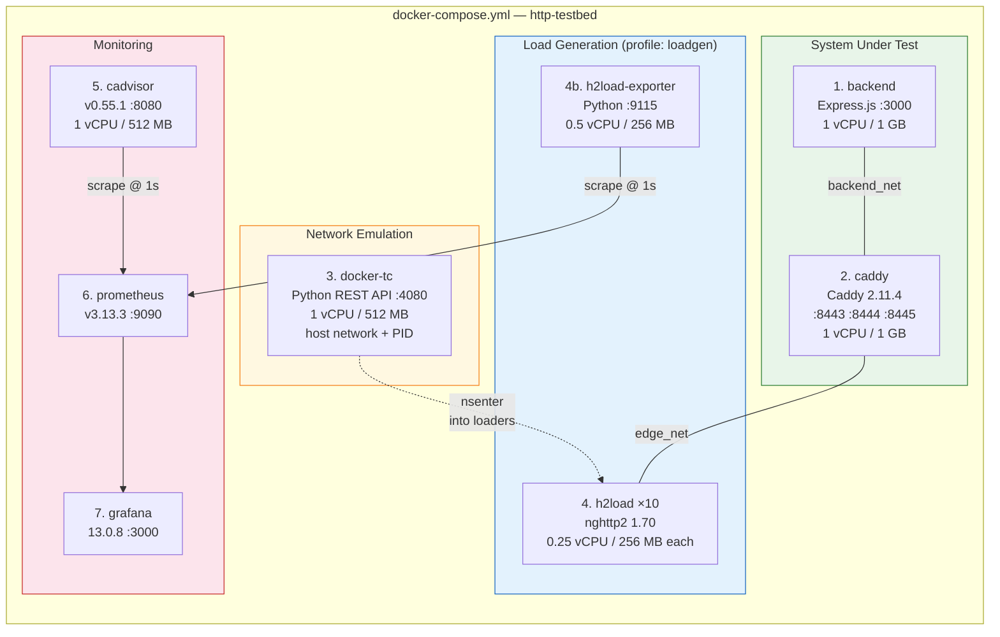
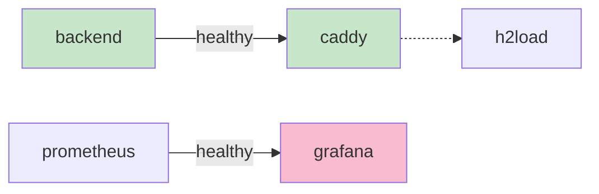

# Docker Services

All services are defined in `docker-compose.yml` under the project name `http-testbed`.

## Service Map

## Service Details

### 1. backend

| Property | Value |
| --- | --- |
| Image | `http-testbed/backend:latest` (custom build) |
| Base | `node:24` |
| Port | 3000 (internal) |
| Resources | 1 vCPU, 1 GB RAM |
| CPU Pin | `CPUSET_BACKEND` (default: `0-1`) |
| Healthcheck | `wget -qO- http://127.0.0.1:3000/health` |
| Network | `backend_net` |

### 2. caddy

| Property | Value |
| --- | --- |
| Image | `caddy:2.11.4` (official) |
| Ports | 8443 (HTTP/1.1), 8444 (HTTP/2), 8445 (HTTP/3), 2019 (admin) |
| Resources | 1 vCPU, 1 GB RAM |
| CPU Pin | `CPUSET_CADDY` (default: `2-3`) |
| Healthcheck | `wget -qO- http://127.0.0.1:2019/config/` |
| Networks | `edge_net`, `backend_net`, `monitoring_net` |

### 3. docker-tc

| Property | Value |
| --- | --- |
| Image | `http-testbed/docker-tc:latest` (custom build) |
| Port | 4080 (host network) |
| Resources | 1 vCPU, 512 MB RAM |
| CPU Pin | `CPUSET_SUPPORT` (default: `8-11`) |
| Privileges | `privileged: true`, `network_mode: host`, `pid: host` |
| Healthcheck | Python urllib check on `:4080/health` |

### 4. h2load

| Property | Value |
| --- | --- |
| Image | `http-testbed/h2load:latest` (custom build, multi-stage) |
| Profile | `loadgen` (hidden from `docker compose up`) |
| Resources | 0.25 vCPU, 256 MB RAM **per container** |
| CPU Pin | `CPUSET_LOADER` (default: `4-7`) |
| Network | `edge_net` |
| Restart | `no` (one-shot per run) |

### 4b. h2load-exporter

| Property | Value |
| --- | --- |
| Image | `http-testbed/h2load-exporter:latest` |
| Port | 9115 (internal) |
| Resources | 0.5 vCPU, 256 MB RAM |
| Network | `monitoring_net` |

### 5–7. Monitoring Stack

| Service | Image | Port | Purpose |
| --- | --- | --- | --- |
| cadvisor | `gcr.io/cadvisor/cadvisor:v0.55.1` | 8080 | Per-container CPU/memory from cgroups |
| prometheus | `prom/prometheus:v3.13.3` | 9090 | Time-series database, 30-day retention |
| grafana | `grafana/grafana:13.0.8` | 3000 | Dashboards (auto-provisioned) |

## Dependency Graph

Services start in dependency order:

1. `backend` starts first and becomes healthy
2. `caddy` waits for backend health, then starts
3. `prometheus` starts independently
4. `grafana` waits for prometheus health
5. `docker-tc`, `cadvisor`, `h2load-exporter` start independently
6. `h2load` containers are launched per-run by the campaign script
