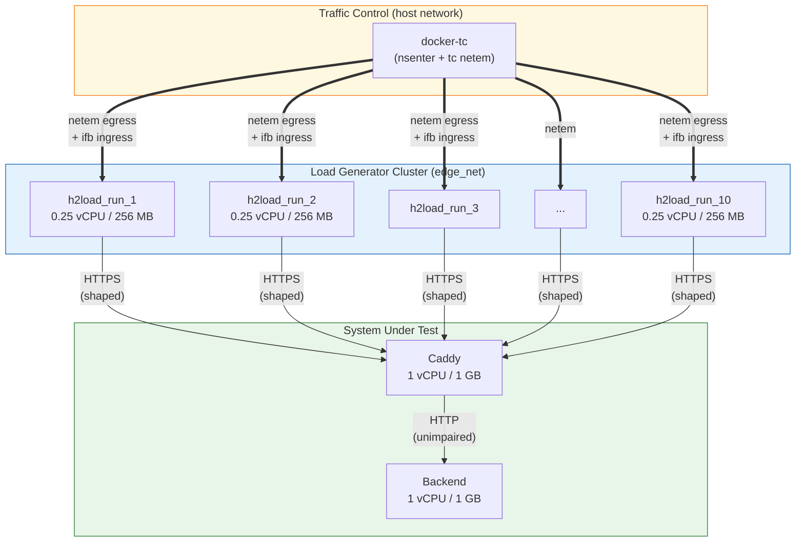
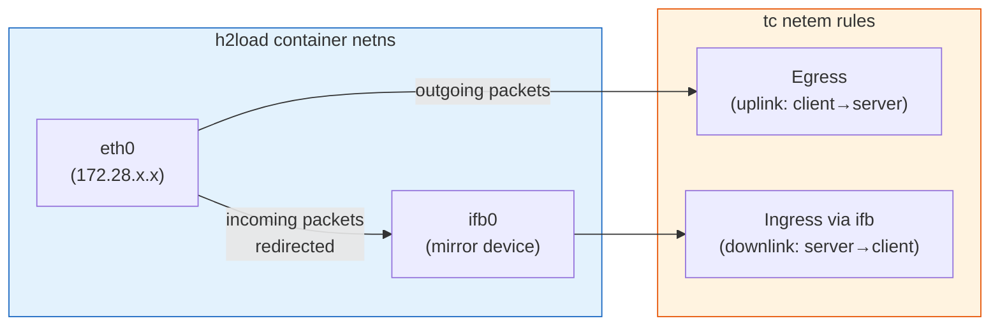

# Network Topology

This page details how network emulation is structured and applied in the testbed.

## Topology Overview



## Per-Client Link Emulation

Unlike traditional approaches that shape the server's interface (affecting all clients equally), this testbed shapes **each loader's individual interface**. This models real-world conditions where every client has its own last-mile link.

### How It Works



1. **Egress shaping (uplink):** A `netem` qdisc is attached to the loader's `eth0` root. All outgoing packets (requests) pass through it and experience the configured delay, jitter, loss, and rate limit.

2. **Ingress shaping (downlink):** Linux `tc netem` is egress-only by design. To shape incoming packets (responses), the testbed:
   - Creates an `ifb0` (Intermediate Functional Block) device inside the loader's network namespace
   - Adds an `ingress` qdisc on `eth0` with a `u32` filter that redirects all incoming traffic to `ifb0`
   - Applies the same `netem` rules on `ifb0`'s root qdisc

This creates a **symmetric** emulated link where both directions experience identical impairment.

### Interface Auto-Detection

docker-tc automatically detects the correct interface to shape by scanning the container's network namespace for an IPv4 address on the `172.28.0.0/24` edge subnet:

```
nsenter -t <pid> -n ip -o -4 addr show
→ "3: eth0    inet 172.28.0.5/24 brd ..."
→ Selected: eth0 (matches EDGE_SUBNET_PREFIX=172.28.)
```

## Emulation Parameters

Each network scenario defines four parameters that map to `tc netem` arguments:

| Parameter | netem Argument | Direction | Example |
| --- | --- | --- | --- |
| `delay` | `netem delay <ms>` | Both (one-way) | `35ms` → 70 ms RTT |
| `jitter` | appended after delay | Both | `5ms` |
| `loss` | `netem loss <pct>` | Both | `2%` |
| `rate` | `netem rate <bps>` | Both | `20mbit` |


The `delay` value is **one-way**. Since it is applied symmetrically (egress + ingress), the effective round-trip time is **2 × delay**. For example, `delay=35ms` produces a 70 ms RTT.

