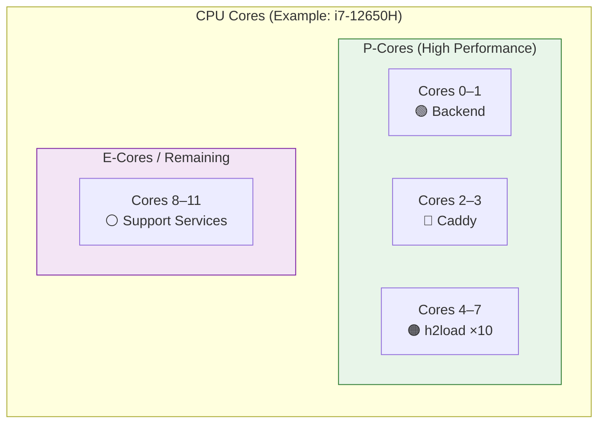
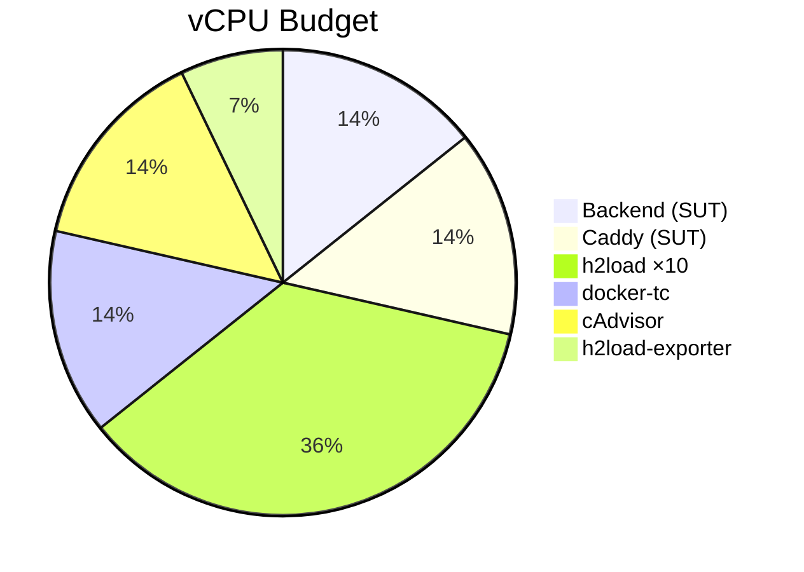

# Resource Limits & CPU Pinning

Precise resource control ensures that load generators never compete with the system under test for CPU or RAM, eliminating measurement bias.

## CPU Core Layout

The testbed assigns dedicated CPU cores to each role:



| Role | Cores | `cpuset` | `cpus` Quota | RAM Limit |
| --- | --- | --- | --- | --- |
| **Backend** (SUT) | 0–1 | `CPUSET_BACKEND` | 1.0 vCPU | 1 GB |
| **Caddy** (SUT) | 2–3 | `CPUSET_CADDY` | 1.0 vCPU | 1 GB |
| **h2load** ×10 (load) | 4–7 | `CPUSET_LOADER` | 0.25 vCPU each | 256 MB each |
| **docker-tc** (support) | 8–11 | `CPUSET_SUPPORT` | 1.0 vCPU | 512 MB |
| **cAdvisor** (support) | 8–11 | `CPUSET_SUPPORT` | 1.0 vCPU | 512 MB |
| **Prometheus** (support) | 8–11 | `CPUSET_SUPPORT` | — | — |
| **Grafana** (support) | 8–11 | `CPUSET_SUPPORT` | — | — |
| **h2load-exporter** (support) | 8–11 | `CPUSET_SUPPORT` | 0.5 vCPU | 256 MB |

## Resource Budget



### Total resource usage:
- **System Under Test:** 2 vCPU, 2 GB RAM
- **Load Generation:** 2.5 vCPU, 2.56 GB RAM
- **Support/Monitoring:** 2.5+ vCPU, 1.25+ GB RAM

## Why CPU Pinning Matters

Without CPU pinning, Docker containers share the host's CPU scheduler freely. This means:

1. A load generator spike could starve the backend of CPU time
2. A Prometheus scrape could cause a latency spike in the measured traffic
3. E-core scheduling could silently reduce throughput of the SUT

By pinning the **system under test** (backend + Caddy) to dedicated P-cores and the **load generators** to their own cores, we ensure:

- ✅ Backend and Caddy never contend with each other
- ✅ Load generators cannot steal CPU from the SUT
- ✅ Support services (docker-tc, monitoring) run on separate cores
- ✅ Reproducible CPU conditions across all 150 runs

## YAML Anchors

The `docker-compose.yml` uses YAML anchors to define resource limits once and reuse them:

```yaml
x-limits-backend: &limits-backend
  cpus: "1.0"
  mem_limit: 1g

x-limits-caddy: &limits-caddy
  cpus: "1.0"
  mem_limit: 1g

x-limits-docker-tc: &limits-docker-tc
  cpus: "1.0"
  mem_limit: 512m

x-limits-h2load: &limits-h2load
  cpus: "0.25"
  mem_limit: 256m
```

Each service then applies its limits via `<<: *limits-backend` (merge key syntax).


**WSL2 limitation:** Container `cpuset` pins to the WSL2 VM's virtual CPUs, but Windows can still migrate those vCPU threads across physical P/E cores. For strict hardware-level pinning, either run on native Linux or manually pin the WSL2 VM process to host P-cores via Windows CPU affinity.

