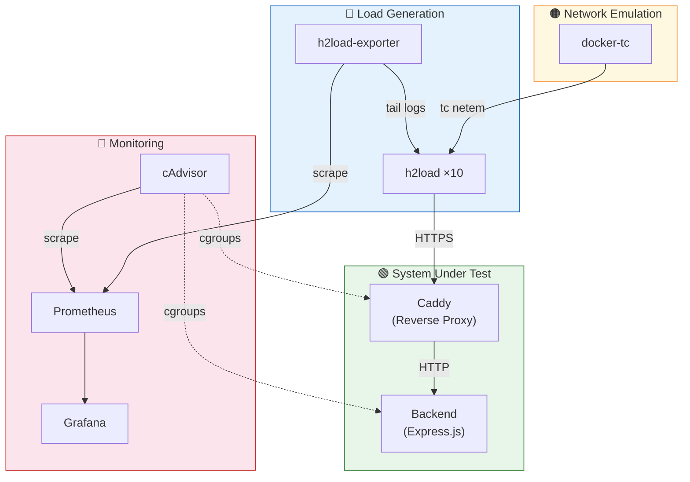

# Components Overview

The testbed is composed of seven Docker services organized into four functional groups.

## Component Diagram

## Component Summary

| Component | Technology | Role | Page |
| --- | --- | --- | --- |
| Backend | Node.js 24 + Express 4 | Fixed-payload API endpoint | [Backend](backend.md) |
| Caddy | Caddy 2.11.4 | TLS termination, protocol isolation | [Caddy](caddy.md) |
| docker-tc | Python 3 + tc netem | Symmetric network emulation | [docker-tc](docker-tc.md) |
| h2load | nghttp2 1.70 | Load generation (HTTP/1.1, 2, 3) | [h2load](h2load.md) |
| Monitoring | Prometheus + Grafana + cAdvisor | Metrics collection & visualization | [Monitoring](monitoring.md) |
