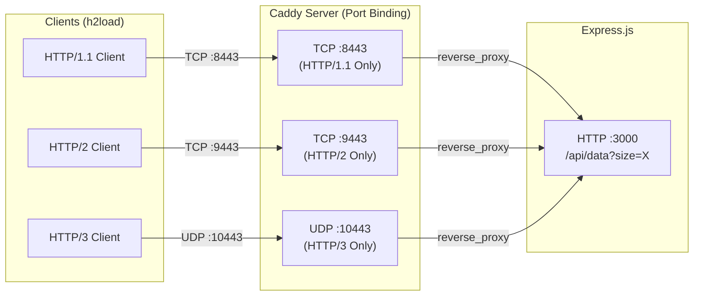

# Caddy Reverse Proxy

Caddy (`caddy/`) serves as the TLS termination point and protocol isolation layer for the testbed. It routes incoming requests from client containers to the upstream Express.js backend.

## Why Caddy?

1. **Native HTTP/3 Support**: Powered by `quic-go`, Caddy provides production-grade HTTP/3 (over QUIC/UDP) alongside HTTP/1.1 and HTTP/2 (over TCP).
2. **Automatic Self-Signed Certificates**: Uses Caddy's internal certificate authority (`tls internal`) without requiring external ACME interactions.
3. **High Performance**: Minimal overhead when proxying requests over the high-speed loopback / internal Docker bridge.

## Protocol Isolation Architecture

To prevent protocol negotiation interference (e.g. ALPN fallback or HTTP/2 upgrading to HTTP/3), Caddy listens on distinct dedicated ports:



## Caddy Configuration (`Caddyfile`)

```caddy
{
    admin off
    auto_https off
    log {
        output stdout
        format json
        level WARN
    }
}

# HTTP/1.1 endpoint
:8443 {
    tls /etc/caddy/certs/cert.pem /etc/caddy/certs/key.pem {
        alpn http/1.1
    }
    reverse_proxy backend:3000
}

# HTTP/2 endpoint
:9443 {
    tls /etc/caddy/certs/cert.pem /etc/caddy/certs/key.pem {
        alpn h2
    }
    reverse_proxy backend:3000
}

# HTTP/3 endpoint (UDP)
:10443 {
    tls /etc/caddy/certs/cert.pem /etc/caddy/certs/key.pem {
        alpn h3
    }
    reverse_proxy backend:3000
}
```

## Container Specifications

| Attribute | Specification |
| --- | --- |
| Image | `caddy:2.11.4-alpine` |
| CPU Pinning | Core 2 (`cpuset: "2"`) |
| CPU Quota | 2.0 vCPU |
| Memory Limit | 1 GB RAM |
| Networks | `edge_net` (ingress), `backend_net` (egress) |
| Exposed Ports | `8443/tcp`, `9443/tcp`, `10443/udp` |
