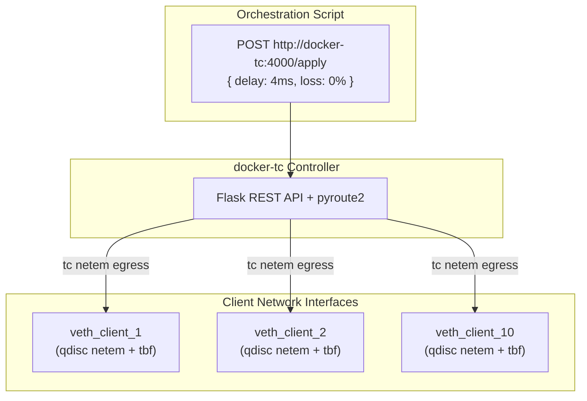

# docker-tc (Network Emulation)

`docker-tc` controls network conditions (latency, jitter, packet loss, bandwidth limits) across the testbed using Linux kernel Traffic Control (`tc`) and Network Emulation (`netem`).

## Role in Architecture

Rather than throttling the server interface, `docker-tc` injects queuing disciplines (qdiscs) directly into the virtual network interfaces of each client container.



## Symmetric Traffic Shaping via IFB

By default, Linux `tc netem` operates solely on egress (outbound) traffic. To achieve true bi-directional (symmetric) WAN emulation:
1. An Intermediate Functional Block (`ifb`) virtual device is dynamically created.
2. Ingress traffic is redirected from `eth0` to `ifb0` using `tc filter`.
3. The specified `netem` and token bucket filter (`tbf`) rules are applied identically to both outbound (`eth0`) and inbound (`ifb0`) queues.

## REST API Endpoints

`docker-tc` exposes an internal REST API on port `4000`:

| Method | Endpoint | Description |
| --- | --- | --- |
| `POST` | `/apply` | Apply network scenario parameters (delay, loss, rate, jitter) |
| `POST` | `/reset` | Flush all qdisc rules and return to unthrottled loopback speed |
| `GET` | `/status` | Query active qdisc rules across managed interfaces |

### Example Payload (`/apply`)

```json
{
  "target": "edge_net",
  "delay": "40ms",
  "jitter": "2ms",
  "loss": "1%",
  "rate": "50mbit"
}
```
