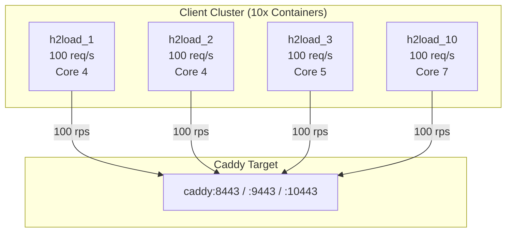

# h2load (Load Generator)

`h2load` (part of the `nghttp2` project) is a high-performance benchmarking tool capable of generating sustained traffic over HTTP/1.1, HTTP/2, and HTTP/3.

## Multi-Container Load Cluster

Rather than running a single client process (which would bottleneck on a single core or socket), load generation is partitioned across 10 identical Docker containers (`h2load_run_1` to `h2load_run_10`).



## Compilation and Features

The container image is custom-built on Alpine Linux with the following compilation flags:
- `nghttp2` v1.70.0
- `ngtcp2` + `nghttp3` enabled for full HTTP/3 (RFC 9114) support
- OpenSSL with QUIC support (`quictls`)

## Command Arguments

During a test run, each container executes `h2load` with calibrated parameters:

```bash
h2load \
  --h1 / --h2 / --h3 \
  -n 8000 \
  -c 10 \
  -m 10 \
  -t 2 \
  --rate=100 \
  --duration=80s \
  https://caddy:${PORT}/api/data?size=${PAYLOAD_SIZE}
```

| Flag | Meaning | Value in Benchmark |
| --- | --- | --- |
| `-c` | Concurrent clients/connections | 10 per container (100 total) |
| `-m` | Max concurrent streams per connection | 10 streams |
| `-t` | Worker threads | 2 threads |
| `--rate` | Target rate injection | 100 requests/sec |
| `--duration` | Total test duration | 80 seconds |
| `--h1 / --h2 / --h3` | Protocol selection | Configured per matrix cell |
