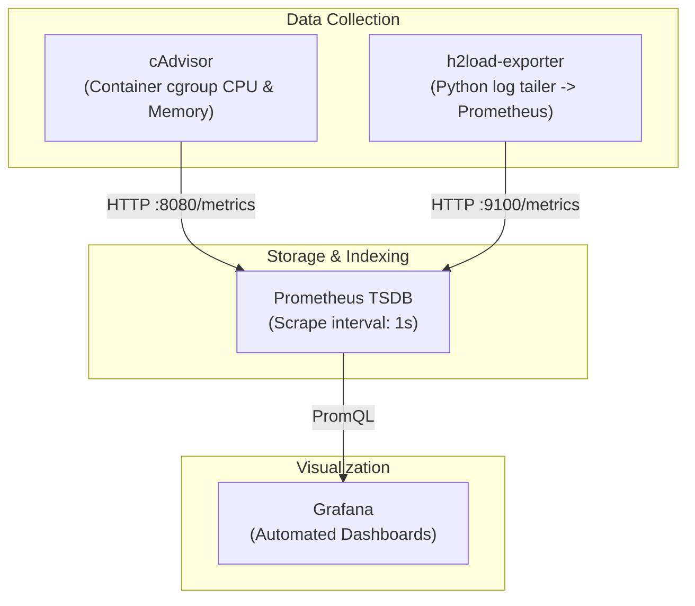

# Monitoring Stack

The monitoring subsystem collects, exports, aggregates, and visualizes real-time metrics during benchmark execution.

## Subsystem Architecture

## Components

### 1. h2load-exporter (`monitoring/exporter/`)
A custom Python 3 daemon (`h2load_exporter.py`) running inside the monitoring network. It:
- Watches stdout logs produced by the 10 `h2load` containers.
- Parses per-second throughput, request latencies (min, mean, max, sd), and status code distributions (2xx, 3xx, 4xx, 5xx).
- Exposes standard Prometheus metrics on `:9100/metrics`.

### 2. cAdvisor
Monitors hardware utilization directly from Linux cgroups without touching application code:
- Tracks instantaneous CPU usage (cores used, throttle count).
- Tracks resident memory usage and network socket statistics for `backend` and `caddy`.

### 3. Prometheus
- Retention: Configured for the entire experimental campaign duration.
- Scrape interval: 1.0 second for high-resolution transient analysis.
- Network: Isolated on `monitor_net` to prevent scrape traffic from impacting `edge_net`.

### 4. Grafana
Pre-provisioned with custom dashboards:
- **Experiment Live Overview**: Real-time throughput, TTFB, and latency percentiles.
- **Protocol Comparison**: Side-by-side comparative views across HTTP/1.1, HTTP/2, and HTTP/3.
- Access URL: `http://localhost:3001` (default credentials: `admin` / `admin`).
