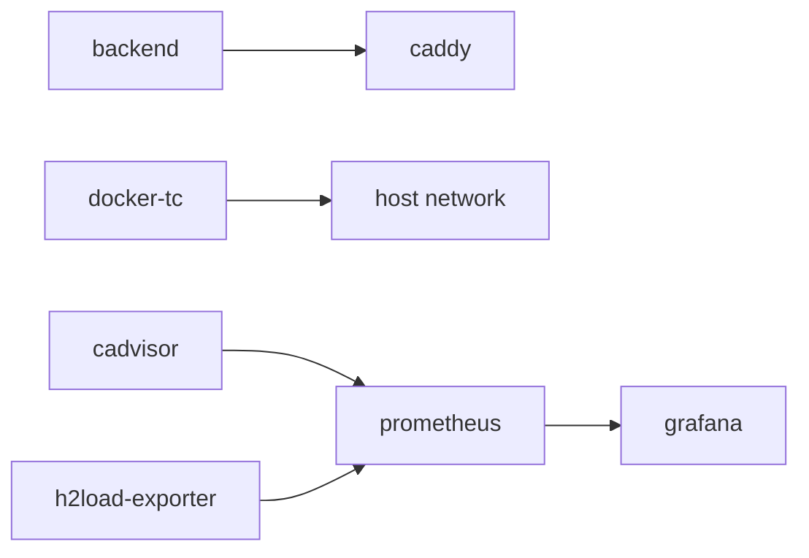

# Installation & Setup

## 1. Clone the Repository

```bash
git clone https://github.com/WilsonnnTan/Skripsi-230024-Wilson-Angelie-Tan.git
cd Skripsi-230024-Wilson-Angelie-Tan
```

## 2. Configure Environment Variables

Copy the example environment file and adjust as needed:

```bash
cp .env.example .env
```

The most important settings to verify are the **CPU pinning** ranges. Check your host's CPU topology:

```bash
lscpu -e   # Run inside WSL2 if on Windows
```

Then edit `.env` to match your cores:

```dotenv
# System under test — pin to P-cores
CPUSET_BACKEND=0-1
CPUSET_CADDY=2-3

# Load generators — their own P-cores
CPUSET_LOADER=4-7

# Support services — E-cores or remaining cores
CPUSET_SUPPORT=8-11
```


The default values target an Intel i7-12650H where logical CPUs 0–11 are P-core threads and 12–15 are E-cores. Adjust for your specific hardware.


## 3. Build All Images

The testbed includes custom Docker images for the backend, Caddy configuration, docker-tc, h2load, and the metrics exporter. Build them all at once:

```bash
docker compose --profile loadgen build
```

This builds:

| Image | Description | Build Time |
| --- | --- | --- |
| `http-testbed/backend` | Express.js API | ~30 seconds |
| `http-testbed/docker-tc` | Network emulation controller | ~1 minute |
| `http-testbed/h2load` | Load generator with HTTP/3 | **10–30 minutes** (compiles nghttp2 from source) |
| `http-testbed/h2load-exporter` | Live metrics exporter | ~15 seconds |


The `h2load` image compiles nghttp3, ngtcp2, and nghttp2 from source to enable HTTP/3 support. This is the longest build step. The image is built once and reused for all 150 runs.


## 4. Start the Infrastructure Stack

Start all services **except** the load generators (those are launched per-run by the campaign script):

```bash
docker compose up -d
```

This brings up:



## 5. Verify Services Are Ready

```bash
./scripts/wait_for_services.sh
```

This script:

1. ✅ Checks all container health statuses
2. ✅ Probes service endpoints (docker-tc API, Prometheus, h2load-exporter)
3. ✅ Applies a throwaway netem rule to verify `tc` works
4. ✅ Runs a ping test to confirm symmetric shaping adds the expected RTT

If all checks pass, the testbed is ready for experimentation.
