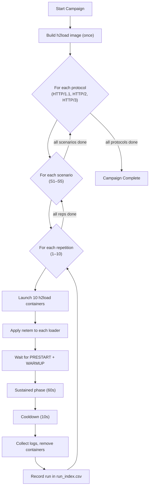

# Quick Start

This page walks you through running the full experiment campaign and exporting results.

## Run All 150 Experiments

```bash
./scripts/run_experiments.sh
```

This single command orchestrates the entire campaign:




**Expected duration:** approximately **5 hours** for all 150 runs (80 seconds per run + 8 seconds cooldown between runs).


## Export Results to CSV

After the campaign completes:

```bash
./scripts/export_results.sh
```

This produces three files in the `results/` directory:

| File | Description |
| --- | --- |
| `summary.csv` | One row per run (sustained phase metrics) |
| `summary_aggregated.csv` | Mean ± std across 10 repetitions |
| `summary_by_phase.csv` | One row per run × phase (warmup/sustained/cooldown) |

## View Dashboards

Open Grafana at **http://localhost:3000** (login: `admin` / `admin`).

Two pre-configured dashboards are available:

- **HTTP Testbed - Live**: Watch the active run in real time
- **HTTP Testbed - Aggregate Analysis**: Compare protocols and scenarios after the campaign

## Analyze Pre-Recorded Data

If you want to analyze existing data without re-running the 5-hour campaign:

```bash
# 1. Extract the saved Prometheus TSDB
tar -xzf prometheus_data.tar.gz

# 2. Start only the monitoring stack
docker compose up -d prometheus grafana

# 3. Open Grafana at http://localhost:3000

# 4. Check CSV results directly
cat results/summary_aggregated.csv
```
