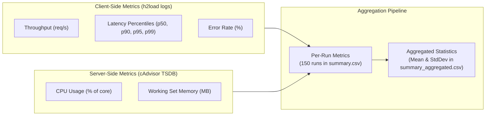

# Metrics & Calculations Overview

The testbed extracts, transforms, and mathematically aggregates performance metrics from both client-side load generators (`h2load`) and server-side container instrumentation (`cAdvisor` via Prometheus).

## Metric Categories

## Data Slicing Principle

All metrics are evaluated exclusively over the **60-second sustained steady-state window** ($t_{warmup}=10\text{s}$ to $t_{cooldown}=70\text{s}$). Startup connection handshakes and cooldown drain periods are deliberately excluded from measurement.

## Detail Pages

- [Client-Side Metrics](client-metrics.md): Exact percentiles, throughput formula, and error classification.
- [Server-Side Metrics](server-metrics.md): PromQL cgroup CPU rate integration and memory working set calculations.
- [Aggregation & Statistics](aggregation.md): Multi-run Bessel correction sample variance, standard deviation, and NaN handling.
