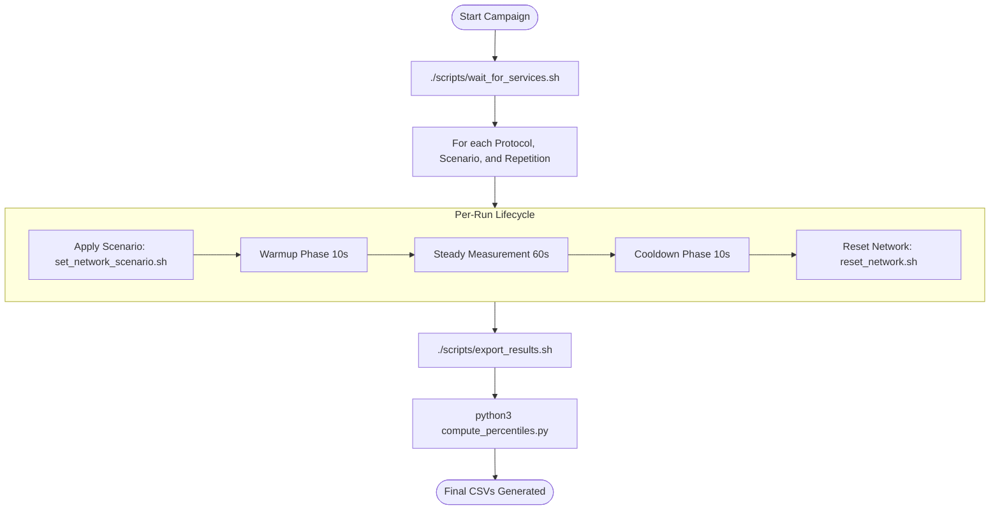

# Automation Scripts Overview

The benchmark campaign is orchestrated entirely by bash and Python scripts located in the `scripts/` directory.

## Script Inventory

| Script | Language | Responsibility |
| --- | --- | --- |
| `run_experiments.sh` | Bash | Orchestrates the 150-run factorial experiment matrix |
| `export_results.sh` | Bash + PromQL | Queries Prometheus and outputs CSV result summaries |
| `set_network_scenario.sh` | Bash + cURL | Communicates with `docker-tc` to enforce network limits |
| `reset_network.sh` | Bash + cURL | Flushes active netem rules between runs |
| `wait_for_services.sh` | Bash | Health-checks services before beginning runs |
| `compute_percentiles.py` | Python 3 | Calculates p50, p90, p95, and p99 statistics from raw metrics |
| `scenarios.conf` | Configuration | Defines parameter values for scenarios S1 through S5 |

## Execution Workflow

