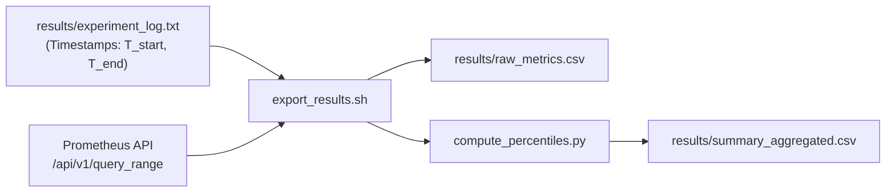

# export_results.sh

`scripts/export_results.sh` extracts metric slices from Prometheus for each run's steady-state window ($t_{warmup}+10\text{s}$ to $t_{cooldown}-10\text{s}$), calculates summary statistics, and generates CSV output files.

## Usage

```bash
./scripts/export_results.sh
```

## Extraction Process



## Key PromQL Queries Used

1. **Throughput (Requests/sec)**:
   ```promql
   sum(rate(h2load_requests_total[10s]))
   ```

2. **Error Rate (%)**:
   ```promql
   sum(rate(h2load_requests_failed_total[10s])) / sum(rate(h2load_requests_total[10s])) * 100
   ```

3. **Client Latency (TTFB)**:
   ```promql
   h2load_latency_seconds{quantile="0.5"}
   ```

4. **Server CPU Utilization**:
   ```promql
   sum(rate(container_cpu_usage_seconds_total{name="backend"}[10s])) by (name)
   ```
