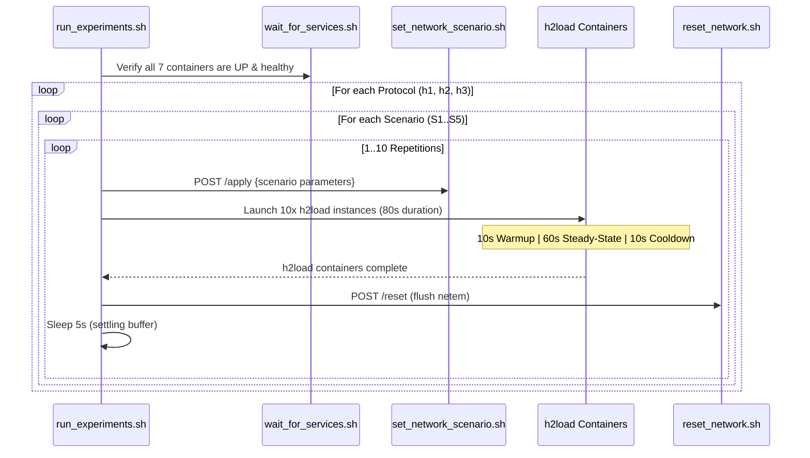

# run_experiments.sh

`scripts/run_experiments.sh` is the master orchestration script that executes the 150-run experimental benchmark campaign.

## Campaign Matrix

The test matrix consists of:
- **3 Protocols**: HTTP/1.1 (`h1`), HTTP/2 (`h2`), HTTP/3 (`h3`)
- **5 Scenarios**: S1 (LAN baseline), S2 (High Latency WAN), S3 (Packet Loss), S4 (Constrained Bandwidth), S5 (Adverse Combined)
- **Total**: 3 × 5 × 10 = 150 runs.

## Usage

```bash
# Execute entire 150-run matrix
./scripts/run_experiments.sh

# Target specific protocol or scenario
PROTOCOL=h3 SCENARIO=S3 ./scripts/run_experiments.sh
```

## Internal Workflow



## Logging and Checkpoints

Each run writes its execution metadata and timestamps to `results/experiment_log.txt`:
```text
[2026-10-18 10:00:00] RUN 001/150: PROTO=h1 SCEN=S1 REP=01 START=1729245600 END=1729245680
[2026-10-18 10:01:25] RUN 002/150: PROTO=h1 SCEN=S1 REP=02 START=1729245685 END=1729245765
```
This checkpoint log enables recovery and deterministic time-window queries against Prometheus.
