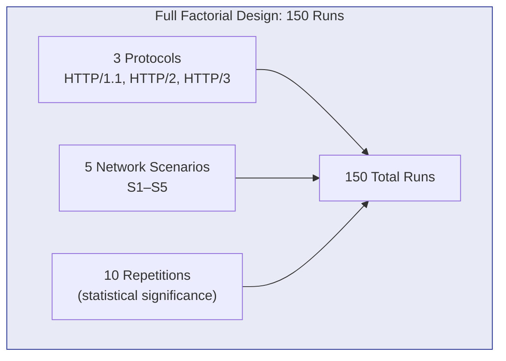
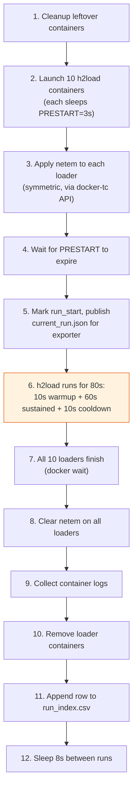

# Experiment Design

The research campaign systematically measures and compares the performance of three HTTP protocol versions under five network conditions.

## Experiment Matrix

$$
3 \text{ protocols} \times 5 \text{ scenarios} \times 10 \text{ repetitions} = 150 \text{ runs}
$$

## Independent Variables

| Variable | Values | Controlled By |
| --- | --- | --- |
| **HTTP Protocol** | HTTP/1.1, HTTP/2, HTTP/3 | Caddy port + h2load ALPN/`--h3` flag |
| **Network Condition** | S1 (baseline) through S5 (long-distance) | docker-tc `tc netem` rules |

## Dependent Variables (Measured)

| Metric | Source | Unit |
| --- | --- | --- |
| **Throughput** | h2load per-request logs | requests/second |
| **Latency** (p50, p90, p95, p99) | h2load per-request logs | milliseconds |
| **Error Rate** | h2load per-request logs | percentage |
| **CPU Usage** (Caddy, Backend) | cAdvisor → Prometheus | percentage |
| **Memory Usage** (Caddy, Backend) | cAdvisor → Prometheus | megabytes |

## Controlled Variables

These parameters are held **constant** across all 150 runs to ensure the protocol is the only variable:

| Parameter | Value | Rationale |
| --- | --- | --- |
| Payload size | 8,192 bytes (8 KiB) | Spans multiple TCP/QUIC packets, but won't saturate slow links |
| Endpoint | `GET /api/data` | Static JSON, no DB/IO → constant application time |
| Concurrent connections | 1 per container × 10 containers | 10 total connections |
| Concurrent streams | 6 per connection | Exercises multiplexing (HTTP/2, HTTP/3) |
| TLS version | TLS 1.3 | Caddy's `tls internal { protocols tls1.3 }` |
| Run duration | 80 seconds (10 + 60 + 10) | 3-phase model |
| Container resources | Fixed per service | CPU + memory limits via compose |

## Single Run Timeline

```mermaid
gantt
    title Single Run Timeline (80 seconds total)
    dateFormat s
    axisFormat %S s

    section Phases
    PRESTART (netem attach)    :pre, 0, 3s
    Warmup                     :warmup, 3, 10s
    Sustained (measured)       :crit, sustained, 13, 60s
    Cooldown                   :cooldown, 73, 10s
    
    section Between Runs
    Cleanup + Rest             :done, rest, 83, 8s
```

## Run Lifecycle

Each of the 150 runs follows this exact sequence:

## Reproducibility Controls

- **Pinned image versions**: Caddy 2.11.4, nghttp2 1.70.0, ngtcp2 1.25.0, nghttp3 1.18.0
- **Fixed Docker subnets**: `172.28.0.0/24`, `172.29.0.0/24`, `172.30.0.0/24`
- **Deterministic payload**: Built once at startup, padded to exactly 8,192 bytes
- **No caching**: `Cache-Control: no-store` + `etag: false` on the backend
- **Resume support**: Already-successful runs are skipped on restart (`RESUME=1`)
