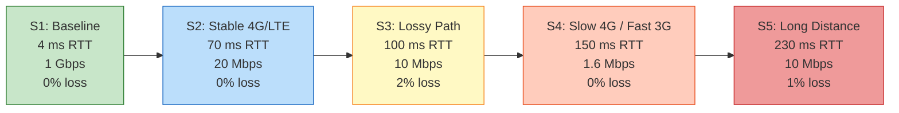

# Network Scenarios

The testbed defines five network scenarios (S1–S5) that cover a range of real-world conditions from ideal LAN to long-distance WAN with packet loss.

## Scenario Overview



## Detailed Parameters

All values are applied **symmetrically** (egress + ingress via `ifb`). The `delay` value is **one-way**, so the effective RTT = 2 × delay.

| Scenario | Description | Bandwidth | One-Way Delay | Jitter | Packet Loss | Effective RTT |
| --- | --- | --- | --- | --- | --- | --- |
| **S1** | Baseline (no impairment) | 1 Gbps | 2 ms | 0 ms | 0% | ~4 ms |
| **S2** | Stable 4G/LTE | 20 Mbps | 35 ms | 5 ms | 0% | ~70 ms |
| **S3** | Lossy path | 10 Mbps | 50 ms | 15 ms | 2% | ~100 ms |
| **S4** | Slow 4G / Fast 3G | 1.6 Mbps | 75 ms | 0 ms | 0% | ~150 ms |
| **S5** | Long distance (high RTT) | 10 Mbps | 115 ms | 20 ms | 1% | ~230 ms |

## Academic Sources

Each scenario's parameters are grounded in published research:

### S1 — Baseline

> RTT 4 ms from WebPageTest FIOS profile; zero-impairment control equivalent to Trevisan et al. (2021) "Native" baseline of a 1 Gbps campus network.

### S2 — Stable 4G/LTE

> - RTT 70 ms: WebPageTest LTE profile, Huang et al. (2013) median handshake RTT, Wolsing et al. (2019) LTE 74 ms
> - 20 Mbps: upper end of Albaladejo et al. (2015) observed 10–20 Mbps LTE range
> - 0% loss: Huang (0.06% median), Albaladejo (<0.35%)
> - 5 ms jitter: design choice within Albaladejo's RTT std-dev range

### S3 — Lossy Path

> - RTT 100 ms: Trevisan et al. (2021) tested level
> - 10 Mbps: Liu et al. (2024) fixed bandwidth
> - 2% loss: both Trevisan and Liu tested this level
> - 15 ms jitter: design choice


This scenario represents a **lossy path**, not "congested 4G." Measured LTE loss is far below 1% in the literature, so claiming this as a 4G profile would be inaccurate.


### S4 — Slow 4G / Fast 3G

> - 1.6 Mbps, 150 ms RTT: directly from Google Lighthouse and WebPageTest "3G Fast" preset
> - No jitter or loss in the source preset

### S5 — Long Distance

> - RTT 230 ms: Gupta & Bartos (2022) measured latency India → US East (~7,500 miles)
> - 1% loss: Trevisan (2021) tested level; Saif et al. (2021) showed stability up to 1.4% at 300 ms
> - 10 Mbps: Liu et al. (2024) fixed bandwidth
> - 20 ms jitter: design choice

## Configuration File

The scenarios are defined in `scripts/scenarios.conf` (sourced by the automation scripts):

```bash
# S1 - Baseline
S1_RATE="1000mbit"
S1_DELAY="2ms"       # RTT 4 ms
S1_JITTER="0ms"
S1_LOSS="0%"

# S2 - Stable 4G/LTE
S2_RATE="20mbit"
S2_DELAY="35ms"      # RTT 70 ms
S2_JITTER="5ms"
S2_LOSS="0%"

# S3 - Lossy path
S3_RATE="10mbit"
S3_DELAY="50ms"      # RTT 100 ms
S3_JITTER="15ms"
S3_LOSS="2%"

# S4 - Slow 4G / Fast 3G
S4_RATE="1600kbit"
S4_DELAY="75ms"      # RTT 150 ms
S4_JITTER="0ms"
S4_LOSS="0%"

# S5 - Long distance
S5_RATE="10mbit"
S5_DELAY="115ms"     # RTT 230 ms
S5_JITTER="20ms"
S5_LOSS="1%"
```
