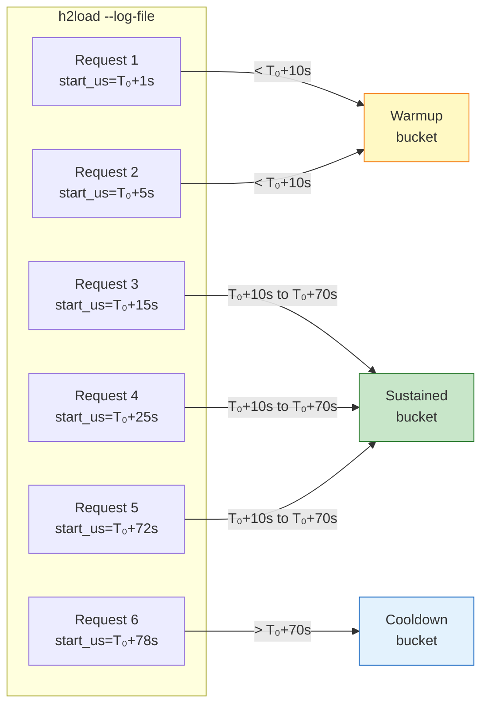

# Phase Model

Each run uses a three-phase model to isolate steady-state behavior from transient startup and shutdown effects.

## Phase Timeline

```mermaid
gantt
    title Run Phase Model (80 seconds)
    dateFormat s
    axisFormat %Ss

    section Pre-Load
    PRESTART (3s)       :pre, 0, 3s

    section Measurement
    Warmup (10s)        :warmup, 3, 10s
    Sustained (60s)     :crit, sustained, 13, 60s
    Cooldown (10s)      :cooldown, 73, 10s
```



| Phase | Duration | Purpose | Used For |
| --- | --- | --- | --- |
| **PRESTART** | 3 seconds | Allow netem rules to be attached to all loaders before traffic starts | Not measured |
| **Warmup** | 10 seconds | Absorb connection setup, TCP slow-start, TLS handshakes, QUIC 0-RTT | Reported separately, not in main results |
| **Sustained** | 60 seconds | Steady-state measurement window | **Primary analysis** |
| **Cooldown** | 10 seconds | Absorb draining effects, final retransmissions | Reported separately, not in main results |

## Phase Slicing

Phases are **not** delegated to h2load's built-in `--warm-up-time` flag. Instead:

1. h2load runs for the **full 80 seconds** with `--duration=80`
2. Every request is timestamped in the `--log-file` (microsecond precision)
3. The analysis pipeline (`compute_percentiles.py`) slices phases by request start time:



Where `T₀` = the earliest request timestamp across all 10 loaders of the run.

## Why This Approach?

The timestamp-based slicing is preferred over timer-based approaches because:

| Approach | Limitation | Our Solution |
| --- | --- | --- |
| h2load `--warm-up-time` | Excludes warmup from logs entirely; cannot verify warmup behavior | Run full duration, slice by timestamp |
| Wall-clock timer | Container startup latency varies; 10 containers don't start simultaneously | Use `T₀` = min(start_us) across all loaders |
| Separate h2load runs | Connection re-establishment between phases would invalidate TCP/QUIC state | Single continuous run, phase = label only |

The `PRESTART` sleep (3 seconds) provides a window for the orchestrator to attach netem rules via docker-tc before any measured traffic flows. The warmup phase (10 seconds) then fully absorbs any residual container startup jitter.

## Log Format

h2load `--log-file` writes one TAB-separated line per request:

```
<start_time_us_since_epoch>\t<HTTP_status>\t<duration_us>
```

| Field | Type | Description |
| --- | --- | --- |
| `start_time_us` | integer | Request start time in microseconds since Unix epoch |
| `status` | integer | HTTP status code; `-1` = connection failure |
| `duration_us` | integer | Request duration in microseconds |

Example:
```
1729267200000000	200	12500
1729267200012500	200	11800
1729267200024300	-1	50000
```
