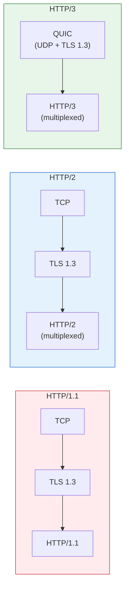
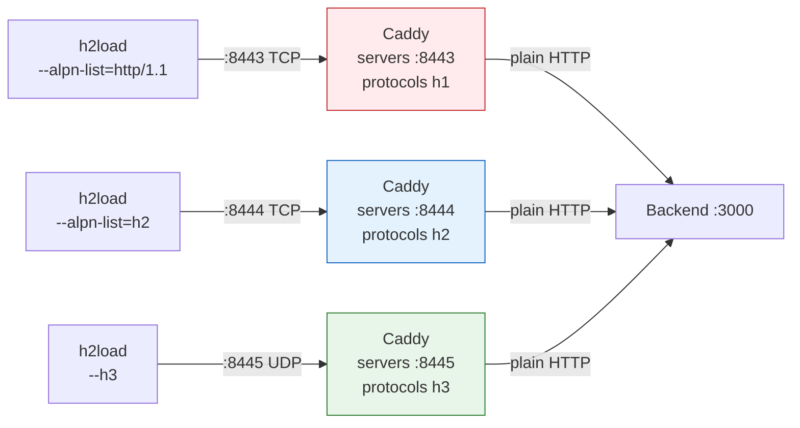
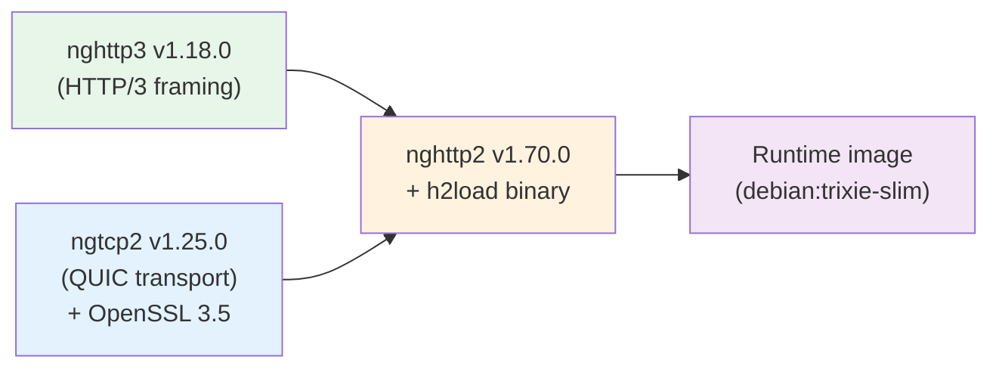

# HTTP Protocols

The testbed measures all three major HTTP protocol versions using a single tool — `h2load` from nghttp2, compiled with HTTP/3 support.

## Protocol Comparison



| Feature | HTTP/1.1 | HTTP/2 | HTTP/3 |
| --- | --- | --- | --- |
| **Transport** | TCP | TCP | QUIC (UDP) |
| **TLS** | Separate (TLS 1.3) | Separate (TLS 1.3) | Integrated in QUIC |
| **Multiplexing** | ❌ No (1 request per connection) | ✅ Yes (stream-level) | ✅ Yes (stream-level) |
| **Head-of-line blocking** | ❌ Connection-level | ❌ TCP-level (across streams) | ✅ Stream-level only |
| **Connection setup** | TCP handshake + TLS handshake | TCP + TLS + SETTINGS | 0-RTT or 1-RTT |
| **Congestion control** | TCP (kernel) | TCP (kernel) | QUIC (user-space) |

## Port Isolation

Caddy serves each protocol on a dedicated port to prevent ALPN ambiguity:



| Protocol | Caddy Port | Transport | h2load Flag |
| --- | --- | --- | --- |
| HTTP/1.1 | `:8443` | TCP | `--alpn-list=http/1.1` |
| HTTP/2 | `:8444` | TCP | `--alpn-list=h2` |
| HTTP/3 | `:8445` | QUIC/UDP | `--h3` |

## Caddyfile Configuration

```caddy
{
    servers :8443 {
        protocols h1
    }
    servers :8444 {
        protocols h2
    }
    servers :8445 {
        protocols h3
    }
}

(tls13) {
    tls internal {
        protocols tls1.3
    }
}

caddy:8443 {
    import tls13
    reverse_proxy backend:3000
}

caddy:8444 {
    import tls13
    reverse_proxy backend:3000
}

caddy:8445 {
    import tls13
    reverse_proxy backend:3000
}
```

All three listeners use `tls internal` (Caddy's built-in CA) with TLS 1.3, and all reverse-proxy to the same backend over plain HTTP internally.

## h2load Build Chain

The h2load binary is compiled from source with HTTP/3 support via a multi-stage Docker build:




**Why build from source?** The nghttp2 package in most distro repositories does not include HTTP/3 support. Building from source with `--enable-http3` and linking against ngtcp2 + nghttp3 is the only way to get all three protocols in a single `h2load` binary.


## Load Parameters

| Parameter | Value | Notes |
| --- | --- | --- |
| Connections (`-c`) | 1 per container | 10 total (10 containers) |
| Streams (`-m`) | 6 | HTTP/1.1 ignores this (1 stream per connection) |
| Threads (`-t`) | 1 | One thread per container |
| Duration (`--duration`) | 80 seconds | Covers all three phases |
